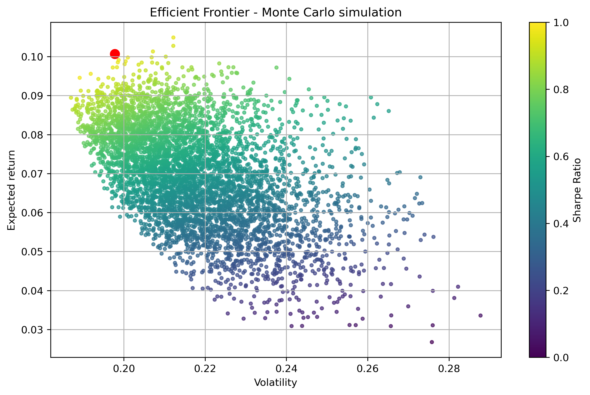
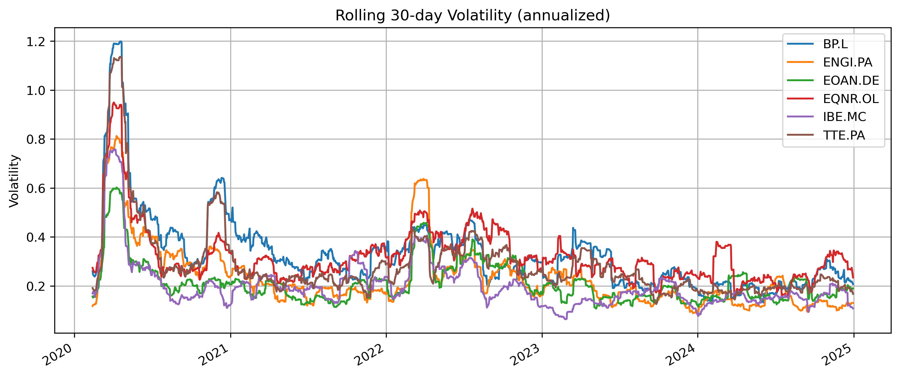
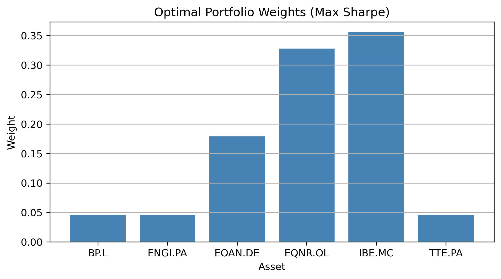

# European Energy Stocks Portfolio Analysis

A quantitative portfolio analysis of major European energy companies using risk metrics, portfolio optimization, and volatility analysis.

## Motivation

This project was built to explore how quantitative portfolio management techniques can be applied to the European energy sector. The objective is to evaluate the risk-return characteristics of energy stocks, identify efficient portfolio allocations, and analyze how market shocks affect asset volatility over time.

## What the Project Does

The analysis is divided into four main stages:

### 1. Data Pipeline

Historical daily price data is collected using Yahoo Finance for a portfolio of major European energy companies:

* E.ON (EOAN.DE)
* Iberdrola (IBE.MC)
* TotalEnergies (TTE.PA)
* BP (BP.L)
* Engie (ENGI.PA)
* Equinor (EQNR.OL)

The dataset is cleaned by handling missing observations and transformed into daily logarithmic returns for further analysis.

### 2. Risk Metrics

Several standard portfolio risk measures are calculated:

* Daily logarithmic returns
* Value at Risk (VaR) at the 95% confidence level
* Annualized volatility
* Sharpe Ratio

These metrics provide insight into downside risk, return consistency, and risk-adjusted performance.

### 3. Portfolio Optimization

A Monte Carlo simulation generates thousands of random portfolios with different asset allocations.

For each portfolio, the following are computed:

* Expected annual return
* Annualized volatility
* Sharpe Ratio

The efficient frontier is constructed, and the portfolio with the highest Sharpe Ratio is identified as the optimal risk-adjusted allocation.

### 4. Rolling Volatility Analysis

A 30-day rolling volatility measure is calculated and annualized to examine how risk evolves over time.

This allows the identification of periods of market stress and comparison of the stability of different energy companies.

## Key Findings (Jan 2020 - Dec 2024, 1'283 Trading days)

| Stock | Annual return | Annual volatility | Sharpe (rf = 0) | Daily VaR 95% |
|---|---|---|---|---|
| Iberdrola | 11.3% | 22.6% | 0.50 | −2.0% |
| Equinor | 13.0% | 33.8% | 0.39 | −3.3% |
| E.ON | 7.6% | 22.9% | 0.33 | −2.3% |
| Engie | 6.6% | 26.6% | 0.25 | −2.2% |
| TotalEnergies | 7.4% | 32.2% | 0.23 | −2.9% |
| BP | −4.2% | 36.4% | −0.12 | −3.3% |

* **Max-Sharpe portfolio** (best of 5,000 simulated portfolios, weights constrained to 5–40%):
  10.1% return, 19.8% volatility, Sharpe 0.51, vs. 6.9% / 21.3% / 0.33 for an equal-weight portfolio.
* **Diversification:** the optimal portfolio is less volatile (19.8%) than any single stock (lowest: Iberdrola, 22.6%) and far below the average stock (29.1%).
* **Allocation:** Iberdrola 35.5%, Equinor 32.8%, E.ON 17.9%, BP / Engie / TotalEnergies 4.6% each (minimum weight).
* **Defensive vs. cyclical:** utilities (Iberdrola, E.ON) were the least volatile (~23%), while oil majors (BP, Equinor, TotalEnergies) ran at 32–36%. BP was the only stock with a negative return.
* **COVID-19 shock:** 30-day annualised volatility peaked in early-to-mid April 2020 for all six stocks, ranging from 60% (E.ON) to 120% (BP), roughly 3× their 2020–2024 average levels.

## Limitations

* In-sample optimisation: weights are chosen and evaluated on the same data, so performance is overstated.
* Risk-free rate set to 0; no transaction costs or rebalancing.
* Returns are in local currencies (GBP, NOK, EUR) with no FX conversion.
* Monte Carlo search approximates the optimum rather than solving it exactly.

## Tech Stack

* Python
* pandas
* numpy
* yfinance
* matplotlib

## How to Run

1. Clone the repository: `git clone https://github.com/RickEvans77/European-Energy-Stocks-Portfolio-Analysis.git`
2. Install dependencies: `pip install -r requirements.txt`
3. Open `European_Energy_Stocks_Portfolio_Analysis.ipynb` and run all cells in order. Results are reproducible (`np.random.seed(42)`).
